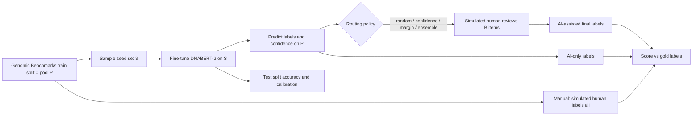

# Frozen evaluation protocol (Prompt 07): DRAFT

Status: draft. **Freeze by committing `configs/frozen_protocol.yaml` to git after baseline validation (Prompt 10) and before the main run.** Changes after that go in the Protocol change log below.

## Definitions
- Input: DNA sequence string (A, C, G, T, N). Output: binary label (class 0 or 1).
- Pool P = official train split (N items). Gold labels of P are hidden from all models and used only for scoring and for simulating humans.
- Seed set S: random subset of P of size s in {100, 300, 1000, 3000}, chosen by a fixed random seed before any model is trained.
- Model: DNABERT-2 (117M) fine-tuned on S. Probabilities on P give predicted label and confidence = max softmax.
- Simulated human: labels an item correctly with probability 1 - e (binary label flipped otherwise). e in {0, 0.05, 0.10}. Optional reliance a in {0, 0.3}: if the AI label is wrong, the human who would have corrected it accepts it anyway with probability a. **These are assumptions, not measured human behaviour.**

## Arms (equal total human labels H = s + B)
| Arm | Human labels used | What happens |
|---|---|---|
| Manual | All N | Human labels every pool item; accuracy 1 - e (reference point, effort 1.0) |
| AI-only | s | Model trained on s seeds labels the rest of P; no review |
| More-labels | H | Model trained on s' = H seeds (from the s grid), labels the rest; no review |
| AI-assisted | s + B | Model trained on s seeds labels P; humans review B items chosen by a routing policy and replace the label |
Budgets are chosen so s + B equals a value in the s grid (e.g., s = 100 with B = 200, 900, 2900), so "More-labels" needs no extra training.
Routing policies: random, least-confidence, margin (top-1 minus top-2 probability), ensemble disagreement (5 seed models, same s, different seeds).

## Metrics (direction)
- Primary: final pool-label accuracy against gold (higher better), as a function of human labels per pool item (lower better).
- Secondary: macro-F1 and MCC on pool labels (higher), test-set accuracy of the seed model (higher), expected calibration error with 15 bins (lower).
- Controls/baselines: majority-class, shuffled-label, package CNN, full-label DNABERT-2.

## Deeper analysis (at least one)
Sensitivity to annotator error e and reliance a; calibration reliability diagram; error analysis of items routing missed (length, GC content, confidence).

## Seeds and compute
- Seeds: 0-4 for seed-set sampling and fine-tuning; separate fixed seed for the simulated human. Record torch/numpy/python seeds.
- Fine-tunes: 5 seeds x 4 sizes x 2 datasets = 40, plus full-label baselines (target 3 seeds per dataset; drop to 1 if slow). Estimated total under 4-5 h (INFERRED; confirm from the pilot).
- Routing, arms and noise simulation are computed post hoc from saved probabilities (no retraining).

## Statistics
Paired differences per seed. 95% bootstrap interval resampling pool items and seeds (note that only 5 seeds limits precision). Decision rule from the brief: gain at least 1 percentage point and the interval excludes 0. No significance claims beyond this.

## Expected outputs
`results/runs.csv` (one row per seed model: dataset, s, seed, test acc, ECE, time), `results/arms.csv` (per arm/policy/e/a/budget accuracy), figures: accuracy vs human labels per item (per dataset), reliability diagram, sensitivity heatmap.

## Architecture diagram

## Threats to validity
Simulated humans; database-derived gold labels; possible train/test duplicates; two binary datasets only; one model family; small seed count; routing evaluated post hoc without retraining; results may not transfer to metadata/ontology annotation.

## Pre-experiment checklist
- [ ] Primary metric, seeds, splits, budgets and decision rule committed to git
- [ ] Duplicate check done and reported
- [ ] Hyperparameters fixed from DNABERT-2 defaults (recorded)
- [ ] Baselines validated (Prompt 10)
- [ ] Test split untouched except for final model accuracy

## Protocol change log
| Date | Change | Reason | Effect on earlier results |
|---|---|---|---|
| | | | |

## Change log addition 2026-11-17 (after pilot, before the main run)
- Added arm `routed_only` (seed labels + reviewed items, no pseudo-labels) for the main cell only (e=0.05, a=0.0, 5 seeds, 3 budget pairs, 4 policies). EXPLORATORY: motivated by the pilot, where 5,000 pseudo-labels (proposer accuracy about 66% at 300 seed labels) dominated the AI-assisted fit. Not part of the pre-registered decision rule in the frozen protocol (commit 92e1e49). Results are reported as exploratory.
- Pilot observation (single seed, one cell: s=300, s'=1000): manual(1000) 0.733 vs AI-assisted 0.663 to 0.670 (all four policies); manual(300) 0.668; AI-only 0.660. Timings: manual about 11 s, AI-only 29 s, AI-assisted about 32.5 s per run.

## Change log addition 2026-11-17 (after the main run)
- The exploratory `routed_only` arm proposed after the pilot was NOT run (the student chose not to run it; the main-run processes also used the earlier labelling.py without it). The main grid is complete: 317 records = 240 AI-assisted + 44 manual + 33 AI-only (student's record count). The explanation that pseudo-label dilution causes AI-assisted < manual remains INFERRED (E45) and will be stated as a limitation, not a finding.
